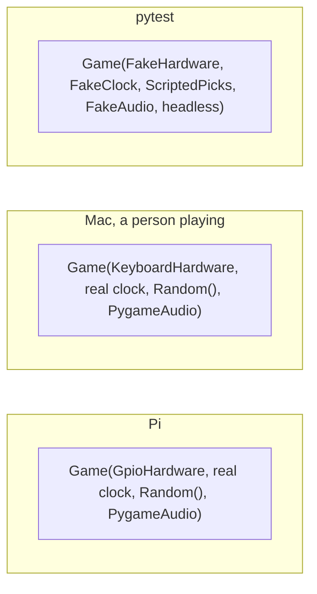

# Plan: a scripted end-to-end test suite

**Status:** draft for Drew's review, 2026-10-26. Open questions are at the end; nothing here is built.

## Goal

`uv run pytest` on the Mac plays whole rounds of the game with no window and no sound, using fake
hardware, a fake clock and scripted prize picks, and passes. Each test that reaches a screen saves a PNG of
it for a person or an agent to look at. The game still runs on the Pi, and Drew has pressed the real button
to prove it.

**Done when:**

- every test in "The tests" below exists and passes with `uv run pytest`;
- the suite never opens a window, plays a sound, or waits on the real clock for game timing;
- `launch.sh` on the Pi starts the game, and a real button press plays a round (Drew checks);
- `AGENTS.md` and `docs/` describe the code as built, and this plan is deleted.

## What the code does today

The game reaches five things outside itself, each directly, so a test cannot control any of them:

| Outside thing | How the code reaches it today | Where |
|---|---|---|
| Hardware (button, LEDs) | Imports `pi2` or `pi_dev2` as a module, chosen by `config.GAME.DEV_MODE` | `game.py:10-15` |
| Clock | `from time import time`, called in every screen | `game.py`, `states/title.py`, `states/candy_picker.py`, `states/winner.py` |
| Prize pick | `random.choices` and `random.choice` | `states/candy_picker.py:257-264` |
| Sound | `pygame.mixer.Sound(...)` built when the module is imported; played through `Game.play_sound` | `states/candy_picker.py:15-71`, `game.py:174` |
| Screen | `pygame.display.set_mode` | `game.py:50-53` |

Three facts the refactor has to respect:

1. **The prize sounds load only because `picker.py` turns on the sound system.** `game.py` imports
   `states/title.py`, which imports `states/candy_picker.py`, which imports `picker.py` (line 3); `picker.py:17`
   calls `pygame.mixer.init()` before `candy_picker.py` builds its sounds at import, and before `Game` calls
   `pygame.init()`. Deleting the `picker.py` import alone breaks the game.
2. **Prize state is shared by the whole process.** Stock, odds and the image cache are module globals in
   `candy_picker.py` (lines 66-73), so one test's round would leak into the next.
3. **The button logic depends on how many signals one press makes.** `pi2.py:44` calls
   `Game.button_press` on every rising and falling edge. `game.py:74-96` posts a press when the pin reads high
   and 1.3 s have passed, and on the next edge that reads high it posts a "release" instead of a press.
   Whether every second real press is swallowed depends on how the button bounces. That is unknown, and the
   fake button has to copy it (Q3).

The hardware calls the game actually makes are `gpio_setup(callback)`, `is_button_pressed()`,
`button_state()`, `led_on()`, `led_off()`, `toggle_led()`, `set_rgb_leds(colors)`, `clear_rgb_leds()` and
`clean()`. `Game.beep_on` and `Game.beep_off` have no callers, and `pi2.py` never sets up the buzzer.

## The design

`Game` takes the five outside things as parameters. The Pi, the Mac and the tests each pass their own.

| Parameter | Pi | Mac | Test |
|---|---|---|---|
| `hardware` | `GpioHardware`: today's `pi2.py` calls, unchanged | `KeyboardHardware`: today's `pi_dev2.py` | `FakeHardware`: records every LED change; `press()` drives the registered callback the way the real pin does |
| `clock` | `time.time` | `time.time` | `FakeClock`: `advance(seconds)` |
| `rng` | `random.Random()` | `random.Random()` | `random.Random(seed)`, or `ScriptedPicks` that returns the prize types a test lists |
| `audio` | `PygameAudio`: loads and plays through `pygame.mixer` | `PygameAudio` | `FakeAudio`: records the file name of each sound played |
| screen | fullscreen | window | SDL `dummy` drivers, set in `tests/conftest.py` before pygame is imported |

Changes to the code, in the order the phases build them:

- **`Game.step()`** runs one frame (time, events, update, draw). `game_loop` calls it; tests call it.
- **Screens ask `Game` for the time, the random source and the sound**: `self.game.now()`,
  `self.game.rng`, `self.game.audio`, never the modules.
- **Prize data is built per `Game`**, after `pygame.init()`, in a `Prizes` object that holds the stock, odds,
  images and sounds. The module globals in `candy_picker.py` go, and so does the `picker.py` import.
- **`hardware.py`** holds `GpioHardware`, `KeyboardHardware` and `FakeHardware` (or `FakeHardware` lives in
  `tests/`; Q4). `pi2.py`, `pi_sound.py` and `buttonhandler.py` stay as they are; `GpioHardware` calls them.
- **`game.main()`** picks the hardware: `GpioHardware` unless dev mode is on (Q1).
- **`pyproject.toml`**: `rpi-lgpio` only on Linux (`; sys_platform == 'linux'`), and pytest in a `dev`
  dependency group, so `uv run pytest` works on the Mac. The Pi does not read this file (`launch.sh` runs
  `/usr/bin/python3`), so this changes nothing there.

## The tests

Each test builds a fresh `Game` with fakes, presses and advances the fake clock, and checks what the game
did: which screen it is on, which sounds played, which LEDs changed, and a saved PNG.

| Test | Proves |
|---|---|
| Title screen idles | The status LED toggles once per second; the screen stays on Title |
| Press starts a spin | One press moves Title → spinning; the first card shows, the LED lights and the beep plays |
| Spin speeds up | Cards change at the intervals in `STEP_RATE_CURVE`, one beep per card; the four LEDs chase in order |
| No big prize too early | Over many seeded spins, no big prize appears before spin `MIN_SPINS_FOR_BIG_PRIZE` (5) |
| Press stops on a prize | A press during the spin moves to Winner with the card on screen; that prize's sound plays; the LEDs clear |
| Timer stops the spin | With no press, the countdown appears at 5 s left and the spin stops at 0 → Winner |
| Winner returns to title | Winner goes back to Title after 5 s, or at once on a press |
| Button bounce | Presses made the way the real button makes them start exactly one round each (after Q3) |
| Odds follow stock | With stock 80 / 50 / 20, picks over many seeded spins land near 53% / 33% / 13% |
| Config files exist | Every sound file and image folder named in `config.py` exists and is not empty |

Screens are saved to `tests/out/<test>/<step>.png` (gitignored). Whether the suite also compares them against
approved images is Q2.

## Phases

Each phase ends with the game still working, so any phase can stop without leaving it broken.

1. **Tools.** `pyproject.toml` changes; `tests/conftest.py` with the dummy drivers; one smoke test that plays
   a round of today's code on the real clock (as the baseline run did). *Done when* `uv run pytest` passes on
   the Mac with that smoke test.
2. **Parameters.** `Game.step()`, the five parameters, the `Prizes` object, `hardware.py`, and the
   `picker.py` import gone. Behaviour does not change. *Done when* the smoke test still passes, the game
   plays on the Mac in a window, and `grep` finds no `from time import time` or `random.` in `states/`.
3. **The suite.** Every test in the table, on the fake clock; the smoke test switches to the fake clock too.
   *Done when* all pass and the run does not wait on real time.
4. **On the Pi.** Push, `git pull --ff-only` on the Pi, restart the game. *Done when* Drew presses the real
   button and a round plays, start to finish.
5. **Close the plan.** `AGENTS.md` gains the test command; `docs/testing.md` says how the suite works and how
   to add a test; decisions go to `docs/decisions.md`; this file is deleted.

## Out of scope

Fixing the bugs the tests find, such as stock that never goes down (Q5); pygame-ce; a live mode where an
agent plays the game by commands; the old files `picker.py`, `pi.py` and `pi_dev.py` beyond removing the one
import; testing `GpioHardware` against fake pins (gpiozero).

## Open questions

- **Q1.** How should dev mode be switched on: an environment variable such as `HALLOWEEN_DEV=1` read by
  `game.main()`, with `config.py` left as committed? Default: yes.
- **Q2.** Should the suite compare screens against approved images and fail on a difference, or only save
  them for review? Default: only save. Approved images would change with every art or font change, and SDL
  draws text slightly differently on the Mac than on the Pi.
- **Q3.** May an agent run a small script on the Pi that logs the button's edges and their timing while Drew
  presses it a few times, so `FakeHardware` presses the way the real button does? Default: yes, during
  phase 3; without it, the bounce test models one clean edge per press.
- **Q4.** Should `FakeHardware` live in `hardware.py` beside the real ones, or in `tests/`? Default:
  `tests/fakes.py`, so the game's code holds only what the game runs.
- **Q5.** The stock never goes down during a night (`candy_picker.py` sets it once at import). Fix it in
  this plan, or only record it with a test marked as a known failure? Default: a known-failure test, and the
  fix as its own change.
